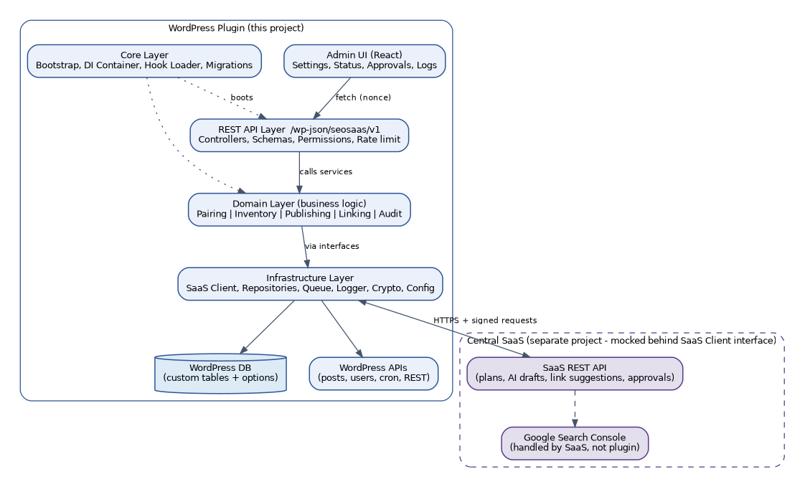
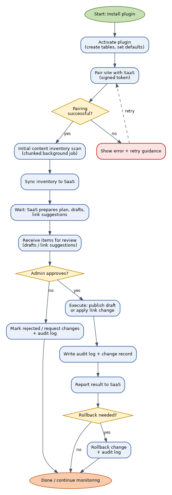
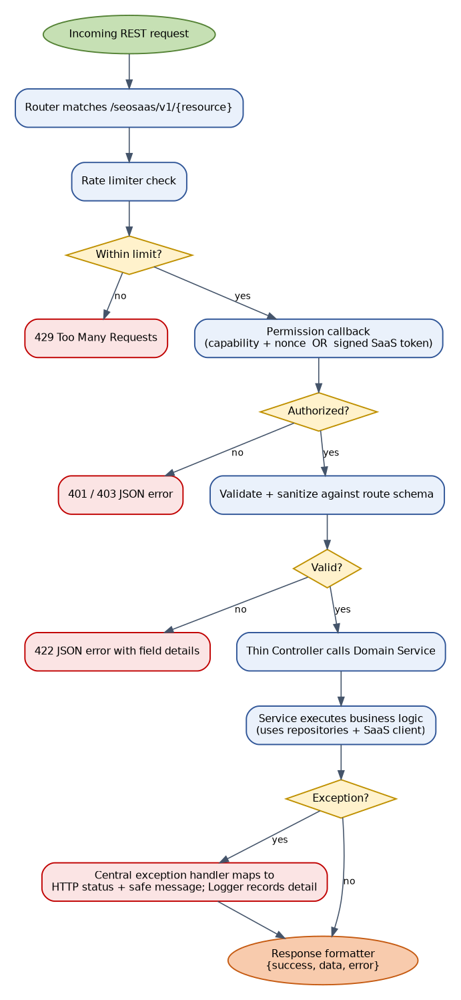
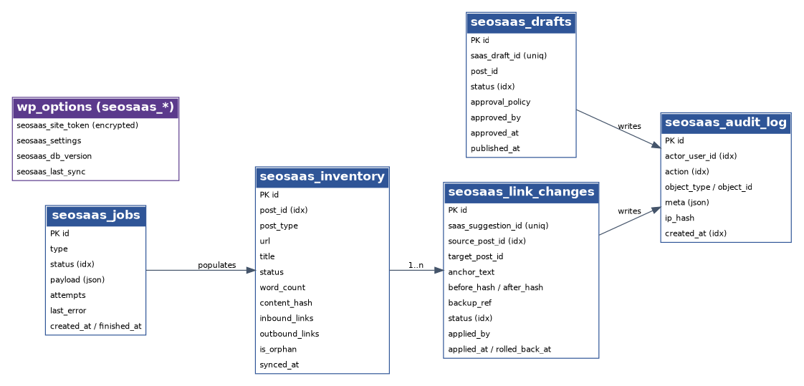
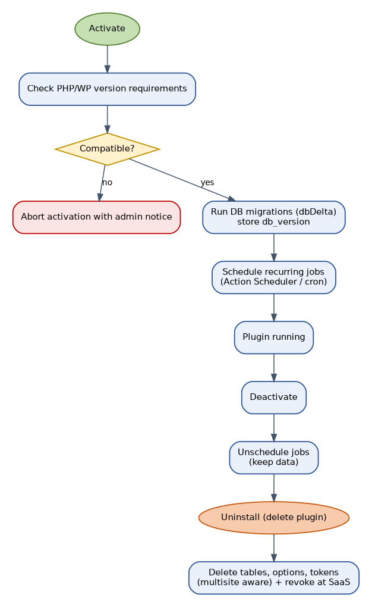

# Architecture

Companion to [REQUIREMENTS.md](REQUIREMENTS.md). Diagram images live in [`docs/diagrams/`](diagrams/).

## 1. Layered architecture

Dependencies point **inward**: UI and API depend on Domain; Domain depends only on interfaces;
Infrastructure implements those interfaces. This keeps business logic separate from UI and makes it
testable without loading WordPress.



```
 SaaS (separate project)  <──signed HTTPS──>  Infrastructure/Saas (HttpSaasClient | MockSaasClient)
                                                        ▲ implements SaasClientInterface
 wp-admin ── React app (assets/admin) ── REST ──> Api (controllers, schemas, permissions, rate limit)
                                                        │ calls
                                                        ▼
                                  Domain (Pairing · Inventory · Publishing · Linking · Audit)
                                                        │ depends on interfaces only
                                                        ▼
        Infrastructure (Wpdb repositories · Queue · Security · WordPress gateways · Config · Logging)
                                                        ▲
                                  Core (bootstrap · container · hook loader · migrator · lifecycle)
```

| Layer | Responsibility | May depend on | Must NOT contain |
|---|---|---|---|
| Core | Bootstrap, DI container, hook registration, migrations runner, activate/deactivate/uninstall | Everything (composition root) | Business rules |
| Domain | Pairing, Inventory, Publishing, Linking, Audit services; entities; value objects; exceptions; ports (interfaces) | PHP stdlib, own interfaces | WordPress functions, `$wpdb`, HTTP, HTML |
| Infrastructure | Adapters: SaaS HTTP client, `$wpdb` repositories, queue, logger, crypto, config, clock | Domain interfaces, WP APIs | Approval or linking decisions |
| Api | REST controllers, route registration, request schemas, permission callbacks, response formatter, rate limiter | Domain services | SQL, direct SaaS calls, HTML |
| Admin | Menu pages, asset enqueue, bootstrap data for React | Config, Api URL helpers | Business logic |
| assets/admin | UI components, stores, service layer | REST API only | Knowledge of PHP internals |

## 2. Repository layout

```
seo-saas-wp-plugin/
├── seo-saas.php                 # plugin header + bootstrap call ONLY
├── uninstall.php                # delegates to Core\Uninstaller
├── readme.txt                   # WordPress.org style (later)
├── README.md  CHANGELOG.md  LICENSE  CODEOWNERS
├── composer.json  package.json  .editorconfig  .gitignore  .distignore
├── phpcs.xml.dist  phpstan.neon.dist  phpunit.xml.dist  .wp-env.json
├── .env.example                 # dev template (real .env is git-ignored)
├── config/
│   ├── defaults.php             # safe defaults for every setting
│   └── environments/            # development.php  staging.php  production.php
├── src/
│   ├── Core/                    # Plugin, Container, HookLoader, Migrator, Activator, Deactivator, Uninstaller
│   ├── Domain/                  # pure business logic — no WP functions
│   │   ├── Pairing/             # PairingService, SiteIdentity, Token (VO)
│   │   ├── Inventory/           # InventoryService, LinkGraphAnalyzer, Item
│   │   ├── Publishing/          # DraftService, ApprovalPolicy, DraftStatus
│   │   ├── Linking/             # LinkSuggestionService, LinkPatcher, Guardrails
│   │   ├── Audit/               # AuditService, AuditEvent
│   │   ├── Contracts/           # ports: SaasClientInterface, *RepositoryInterface, ClockInterface …
│   │   └── Exceptions/
│   ├── Infrastructure/
│   │   ├── Saas/                # HttpSaasClient, MockSaasClient, RequestSigner
│   │   ├── Persistence/         # Wpdb*Repository, Migrations/
│   │   ├── Queue/               # ActionSchedulerQueue, CronQueue, JobRunner
│   │   ├── Security/            # Crypto, SignatureVerifier, RateLimiter
│   │   ├── WordPress/           # PostGateway, SeoPluginAdapters/, BlockConverter
│   │   ├── Config/              # ConfigRepository (constants > env > defaults)
│   │   └── Logging/             # Logger (PSR-3), RedactingFormatter
│   ├── Api/                     # Controllers/, Schemas/, Permissions/, ResponseFormatter, ExceptionHandler, Router
│   ├── Admin/                   # AdminMenu, AssetLoader, BootstrapData
│   └── Support/                 # shared helpers (Sanitizer, …) — single home, no scattered utils
├── assets/admin/                # React app (built to /build)
│   ├── components/              # presentational only
│   ├── screens/                 # Dashboard, Connect, Inventory, …
│   ├── store/                   # @wordpress/data stores
│   ├── services/                # apiClient + one module per resource
│   └── hooks/  utils/  i18n/  index.js
├── tests/                       # Unit/ (no WP)  Integration/ (WP test suite)  fixtures/
├── docs/                        # this folder
├── bin/                         # build-zip.sh, install-wp-tests.sh, check-routes.php
└── .github/                     # workflows/, ISSUE_TEMPLATE/, PULL_REQUEST_TEMPLATE.md
```

## 3. End-to-end flow



1. **Install & activate** — verify PHP/WP versions, create tables via versioned migrations, register capabilities, schedule recurring jobs.
2. **Pair** — admin enters a short-lived pairing code from the SaaS dashboard; plugin exchanges it for a signed site token, verifies the SaaS signature, encrypts and stores the token. ([Diagram 03](diagrams/03-pairing-flow.png))
3. **Inventory** — chunked background scan builds the content inventory and link graph, sends only the changed delta to the SaaS. ([Diagram 04](diagrams/04-inventory-scan-flow.png))
4. **Plan & generate (SaaS side)** — SaaS combines inventory with Search Console data and produces drafts and link suggestions.
5. **Receive** — plugin fetches/receives drafts and suggestions, validates signatures and schemas, sanitises content, stores as WP drafts / proposals.
6. **Approve** — a permitted user previews each item; approval is mandatory per item by default. ([Diagram 05](diagrams/05-draft-approval-publish-flow.png))
7. **Execute** — approved drafts are published/scheduled; approved links are applied with a change record. ([Diagram 06](diagrams/06-link-suggestion-apply-rollback-flow.png))
8. **Record & report** — audit entry written; result reported to SaaS (retried until acknowledged).
9. **Rollback** — link changes revert in one click; published posts can return to draft with an audit entry.

## 4. REST request pipeline



Every route passes: **auth (nonce+capability or signed request) → rate limit → schema validation → controller → service → repository → response formatter**. Any thrown `SeoSaasException` is mapped by `ExceptionHandler` to the consistent envelope; unexpected `Throwable` becomes `seosaas_internal_error` with details only in the log.

## 5. Data model



| Table | Purpose | Indexes |
|---|---|---|
| `seosaas_inventory` | One row per inventoried post/page | UNIQUE(`post_id`); (`post_type`,`status`); (`is_orphan`); (`synced_at`) |
| `seosaas_link_changes` | Suggestions and applied changes with reverse patch | UNIQUE(`saas_suggestion_id`); (`source_post_id`); (`status`) |
| `seosaas_drafts` | Mapping SaaS draft ↔ WP post; approval state | UNIQUE(`saas_draft_id`); UNIQUE(`idempotency_key`); (`status`); (`post_id`) |
| `seosaas_jobs` | Background job tracking and failures | (`status`,`type`); (`created_at`) |
| `seosaas_audit_log` | Append-only audit trail | (`created_at`); (`actor_user_id`); (`action`); (`object_type`,`object_id`) |
| `wp_options` (`seosaas_*`) | Encrypted site token, settings, schema version, last sync | `autoload=no` except tiny flags |

Migration rules: single `seosaas_db_version` option; `Migrator` runs numbered classes in order (`Migration_001_CreateInventory`, …); forward-only, idempotent, tested (run twice = no change); `dbDelta()` formatting rules respected; `$wpdb->get_charset_collate()` and site prefix always; per-site tables on multisite; audit table never stores large content; link backups store only the reversible fragment + position.

## 6. Lifecycle



Activation is fast and safe (failures show an admin notice and deactivate cleanly). Updates detect version change on `plugins_loaded`; heavy migrations are queued, never run inline. Deactivation unschedules jobs and keeps data. Uninstall removes everything unless the user opted to keep data.

## 7. Cross-cutting rules

- **Dependency injection:** tiny PSR-11-style container in a single composition root (`Core/Plugin.php`). Constructors take interfaces. No `new` of infrastructure inside Domain; no static service locators except the container accessor used by hook callbacks.
- **Modules self-register** via `ModuleInterface::register()` so Phase 3 partnership placements can be added without touching existing modules.
- **Extension points:** documented actions/filters such as `seosaas_before_apply_link`, `seosaas_after_publish`.
- **Vendor isolation:** namespace-prefix bundled libraries (Strauss / PHP-Scoper). Production deps are minimal: Action Scheduler, a PSR-3 interface, optional DI container. `vlucas/phpdotenv` is `require-dev` only.
- **Dead/duplicate code policy:** PHPStan level 6+ with dead-code detection, `phpcpd`, ESLint no-unused, `knip`; rule of three; no commented-out code; every feature flag has an owner and removal date.
- **Naming:** PSR-12 PascalCase classes, camelCase methods; `seosaas_` prefix for hooks/options/transients/capabilities/tables; `SEOSAAS_` constants; kebab-case REST routes and JS/CSS files; camelCase JS; PascalCase React components.
- **Comments explain WHY** (intent, constraints, trade-offs), never HOW. PHPDoc on public classes and methods.

## 8. Decision records (ADRs)

Key decisions live as `docs/adr/NNN-title.md`. Initial set to be written in milestone M0: ADR-001 layering and DI, ADR-002 queue library (D-04), ADR-003 signature scheme (D-05), ADR-004 JS state library (D-06), ADR-005 config precedence.
