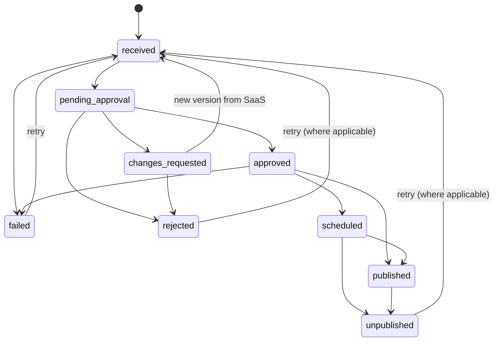

# Requirements Specification (Phase 1 / MVP)

> Living document. Every requirement has a stable ID so it can be changed, split,
> re-prioritised or dropped without breaking references. To change anything, open a
> **Change Request** issue (see [CONTRIBUTING.md](CONTRIBUTING.md#changing-a-requirement))
> and log it in [CHANGE_REQUESTS.md](CHANGE_REQUESTS.md).

Source documents: *Hybrid SEO SaaS + WordPress Plugin – Product Blueprint v1.0* (16 Oct 2026)
and *WordPress SEO Plugin – Requirements Specification v1.0* (18 Oct 2026).

**Priority legend:** **M** = Must (MVP blocker) · **S** = Should (MVP target) · **C** = Could (after MVP)

---

## 1. Scope

| In scope (this repository) | Out of scope (separate projects) |
|---|---|
| WordPress plugin only | SaaS backend, billing, subscriptions (5/10/15 article plans) |
| Secure pairing of a WordPress site with the SaaS | AI content generation and topic strategy |
| Content inventory and internal-link analysis | Google Search Console OAuth and data (SaaS only, never the plugin) |
| Receiving AI drafts and publishing after approval | Partnership marketplace and matching engine (product Phase 3) |
| Internal link suggestions: preview, apply, rollback | Agency / white-label dashboards (product Phase 4) |
| Append-only audit log | Customer-facing SaaS dashboard (Next.js) |
| React admin UI inside wp-admin | **Licensing / subscription API calls** — designed separately, see [SUBSCRIPTION_AND_LICENSING.md](SUBSCRIPTION_AND_LICENSING.md) |
| Versioned REST API exposed by the plugin | |
| Tooling, tests, CI/CD, documentation | |

> **Boundary:** the plugin never talks to Google directly. It only receives already-approved
> instructions from the SaaS and executes them on the WordPress site with the site owner's consent.

### Product context

The product is an AI-powered SEO platform sold as a **subscription (USD-based)**. The first target
market is **travel and tourism websites** (tour operators, hotels, destination blogs, travel
agencies). The plugin is the trusted "hands" of the SaaS inside the customer's WordPress site.

**Non-negotiable product rules**

1. Nothing is published or changed without the configured approval (default: manual for every article and every link).
2. Never promise ranking results — in UI copy, readme or marketing text.
3. No automatic link exchanges. Internal links only in v1; external links / partnership placements are rejected (FR-LNK-011).
4. A SaaS outage must never break the customer's site (O6).

## 2. Assumptions and constraints

- PHP **8.1+**, WordPress **6.4+**, MySQL 5.7+ / MariaDB 10.4+ (decision D-01).
- The SaaS API does not exist yet. The plugin is built against `SaasClientInterface` with a **mock implementation** so work proceeds independently.
- Distributed as a ZIP (private first, WordPress.org later). Never ships secrets, `.env` or dev dependencies.
- Shared hosting is the common target (64–256 MB memory, no persistent workers, sometimes blocked outbound ports). Design must degrade gracefully.

## 3. Objectives and measures of success

| # | Objective | Measure |
|---|---|---|
| O1 | Safe, one-time site connection | Pairing < 2 min; token never visible in UI, logs or DB in plain text |
| O2 | Accurate content inventory | 100 % of indexable posts/pages; re-scan processes only changed items; 5,000-post site scans without timeouts |
| O3 | Controlled publishing | 0 articles published without approval under default policy; result reported to SaaS |
| O4 | Reversible internal linking | Every applied link has a change record; rollback restores original or reports a conflict |
| O5 | Full traceability | Every publish, link edit, pairing, setting and rollback is in the audit log |
| O6 | Never break the customer site | SaaS outage, timeouts or malformed payloads never cause a PHP fatal or slow front-end |
| O7 | Scalable codebase | New module (e.g. partnership placements) added without modifying existing modules except registration |

## 4. Design principles

1. **Human in control** — approve before change, preview before apply, rollback after apply.
2. **Thin controllers, fat services** — controllers translate HTTP; business rules live in Domain services.
3. **Fail safe, fail silent to visitors** — errors go to admins/logs; the public site is never affected.
4. **Everything behind an interface** — SaaS client, storage, clock, logger.
5. **Configuration, not constants** — URLs, keys and flags come from environment configuration.
6. **Idempotent operations** — re-delivering the same draft or suggestion creates no duplicates.
7. **Least privilege** — every route and action checks a specific capability.

## 5. Roles and capabilities

Custom capabilities are registered on activation, granted to Administrator by default and delegable with any role-manager plugin.

| Action | Capability | Admin | Editor | Author- |
|---|---|:-:|:-:|:-:|
| View status / dashboard | `seosaas_view` | ✅ | ✅ | ❌ |
| Pair / unpair site | `seosaas_manage_connection` | ✅ | ❌ | ❌ |
| Change settings and approval policy | `seosaas_manage_settings` | ✅ | ❌ | ❌ |
| Approve / reject drafts | `seosaas_approve_content` | ✅ | ✅ (default) | ❌ |
| Apply / rollback link changes | `seosaas_manage_links` | ✅ | ✅ (default) | ❌ |
| View audit log | `seosaas_view_audit` | ✅ | ❌ | ❌ |
| Trigger manual scan | `seosaas_run_scan` | ✅ | ✅ | ❌ |

## 6. Integration style with the SaaS

- **Pull (primary):** plugin polls `GET /sites/{id}/tasks` (default every 15 min, configurable) and on manual *Sync now*. Works behind firewalls.
- **Push (optional accelerator):** SaaS may call the plugin's `/drafts` and `/links/suggestions` with a signed request; falls back to pull.
- **Report-back:** results (published URL, applied/rolled-back, scan summary) are always sent plugin → SaaS and retried until acknowledged.

---

## 7. Functional requirements

### Module A — Site pairing and connection  *(Diagram 03)*

| ID | Requirement | Pri | Acceptance criteria |
|---|---|:-:|---|
| FR-PAIR-001 | Admin starts pairing by entering a pairing code issued by the SaaS dashboard | M | Valid code → status *Connected*; invalid/expired code shows a safe message and no state change |
| FR-PAIR-002 | Pairing codes are single-use and expire (SaaS-enforced; plugin handles the error) | M | Reusing a code returns `AuthException` mapped to a friendly message |
| FR-PAIR-003 | Plugin sends a site fingerprint: site URL, home URL, WP version, PHP version, plugin version, locale, multisite flag | M | Payload matches schema; no user emails or secrets |
| FR-PAIR-004 | Plugin verifies the SaaS response signature with an embedded SaaS public key before trusting the token | M | Tampered response is rejected and a security event is logged |
| FR-PAIR-005 | Site token encrypted at rest (libsodium secretbox), key from a dedicated constant or WP salts | M | DB dump has no plain-text token; unit test proves encrypt/decrypt round-trip |
| FR-PAIR-006 | Admin can disconnect; plugin revokes token at SaaS, deletes local token, cancels queued jobs | M | After disconnect all SaaS-facing routes return 403 and no job runs |
| FR-PAIR-007 | Detect site URL change (migration / staging clone) and require re-pairing | S | URL mismatch sets *Needs re-pair* and blocks outbound sync |
| FR-PAIR-008 | Connection health check (token valid, SaaS reachable, clock skew in tolerance) shown in UI | S | Health card shows green/amber/red with reason |
| FR-PAIR-009 | Pairing blocked on `SEOSAAS_ENV=staging` unless the staging SaaS URL is configured | S | Staging build cannot pair with production SaaS |

Edge cases: SaaS unreachable during pairing → retry guidance, no partial state · clock skew > 5 min → warn · multisite → pairing is per site (blog), not per network, in v1.

### Module B — Content inventory and link graph  *(Diagrams 04, 08)*

Captured per item: `post_id`, `post_type`, `status`, `url`, `slug`, `title`, `h1`, meta title/description, `word_count`, heading outline, `content_hash`, outbound/inbound internal links (resolved to post IDs), noindex/canonical flags, `modified_gmt`, `synced_at`.

| ID | Requirement | Pri | Acceptance criteria |
|---|---|:-:|---|
| FR-INV-001 | Scan runs as a background job in chunks (default 50 items/batch) via Action Scheduler; never inside a web request | M | 5,000-post site completes without PHP timeout or memory > 128 MB |
| FR-INV-002 | Incremental scan: only items whose `modified_gmt` or hash changed are re-processed | M | Second scan of unchanged site processes 0 items |
| FR-INV-003 | Hook `save_post`, `trashed_post`, `deleted_post`, `transition_post_status` to queue debounced single-item updates | S | Editing a post updates inventory within 5 minutes |
| FR-INV-004 | Detect orphan pages, broken internal links (target 404/trashed) and over-linked pages (configurable threshold) | M | Fixture site with known orphans/broken links is reported exactly |
| FR-INV-005 | Send only the changed delta to SaaS, compressed, ≤ 200 items/page, with idempotency key | M | Network failure retries with no duplicates on SaaS |
| FR-INV-006 | Respect noindex, password-protected, private and excluded post types/taxonomies | M | Excluded items never appear in inventory or payloads |
| FR-INV-007 | Manual *Scan now* with progress (queued / running x of y / done / failed) | S | Progress updates at least every 5 s via status endpoint |
| FR-INV-008 | Broken-link detection uses internal data only in v1 (no HTTP crawl of own pages) | S | No self-HTTP requests during scan |
| FR-INV-009 | Optionally inventory taxonomies and archive URLs as link targets | C | Setting toggles taxonomy items in payload |

### Module C — Draft delivery and publishing  *(Diagram 05)*

Draft payload from SaaS: `saas_draft_id`, `idempotency_key`, `title`, `slug`, `content_html`, `excerpt`, `meta{title,description,focus_keyword}`, `category_names[]`, `featured_image{url,alt}`, `proposed_publish_at`, `internal_links[{target_post_id,anchor}]`.

| ID | Requirement | Pri | Acceptance criteria |
|---|---|:-:|---|
| FR-PUB-001 | Verify request authenticity (signature + timestamp window + nonce) before processing any inbound draft | M | Unsigned, expired or replayed requests get 401 and are logged |
| FR-PUB-002 | Validate payload against a strict schema; reject unknown fields and oversize bodies (default 2 MB) | M | Invalid payload → 422 with field-level errors |
| FR-PUB-003 | Sanitise HTML with an allow-list (`wp_kses` + custom tags); strip scripts, iframes, inline handlers | M | XSS test corpus yields zero executable output |
| FR-PUB-004 | Create post with status `draft` only; never insert as `publish` from an inbound request | M | No code path creates a published post without an approval record (unless auto-publish policy enabled) |
| FR-PUB-005 | Idempotency: same `idempotency_key` never creates a second post; returns existing mapping | M | Replay returns same post ID, HTTP 200 |
| FR-PUB-006 | Convert HTML to Gutenberg blocks (paragraph, heading, list, image, quote, table) | S | Draft opens in the block editor with no "classic block" fallback for supported elements |
| FR-PUB-007 | Store SEO meta via adapters for Yoast / Rank Math / SEOPress / AIOSEO; otherwise plugin meta | S | Adapter test per supported plugin |
| FR-PUB-008 | Resolve categories/tags by name; create only if "allow creating terms" is on | S | Unknown term with setting off is skipped and noted in audit |
| FR-PUB-009 | Featured image: download, validate MIME/size/dimensions, sideload, set alt; block private IP / non-HTTPS hosts (SSRF) | S | Image from private IP range rejected |
| FR-PUB-010 | Approval screen: side-by-side preview; *Approve & Publish*, *Approve & Schedule*, *Request changes*, *Reject* | M | Each action updates status, writes audit and reports to SaaS |
| FR-PUB-011 | Scheduled publishing uses WP `future` status in site timezone | S | Post publishes at chosen time; result reported |
| FR-PUB-012 | On publish report `{saas_draft_id, post_id, permalink, published_at}` to SaaS with retry until acknowledged | M | Offline SaaS: report queued and delivered later |
| FR-PUB-013 | Unpublish: admin can revert a plugin-published post to draft | S | Status changes, SaaS notified, audit written |
| FR-PUB-014 | If admin edits the draft before approval, the edited version is published and SaaS told `modified_by_user=true` | S | Report includes `modified_by_user=true` |
| FR-PUB-015 | Duplicate guard: warn on same slug or near-identical title | C | Warning on approval screen |

**Draft status model**

### Module D — Internal link suggestions, apply and rollback  *(Diagram 06)*

| ID | Requirement | Pri | Acceptance criteria |
|---|---|:-:|---|
| FR-LNK-001 | Accept `{suggestion_id, source_post_id, target_post_id, anchor_text, context_snippet}` and store as `proposed` | M | Duplicate `suggestion_id` ignored (idempotent) |
| FR-LNK-002 | Validate: both posts exist and are published; target indexable; anchor non-empty, ≤ 8 words, not a bare URL; source ≠ target | M | Invalid suggestions rejected with reason logged |
| FR-LNK-003 | Store a snapshot hash of source content at proposal time | M | Hash present on every stored suggestion |
| FR-LNK-004 | Preview shows exact before/after paragraph with link highlighted, plus target title and URL | M | Preview matches final saved HTML |
| FR-LNK-005 | Apply: verify hash → store reverse patch → insert anchor in matching text node only (never in headings, links, buttons, shortcodes, code blocks) → `wp_update_post` with revision → re-inventory | M | Integration tests cover headings, existing links, shortcodes, block boundaries |
| FR-LNK-006 | If source changed since snapshot, block apply and request refreshed suggestion; never apply blindly | M | Conflict returns 409 with UI explanation |
| FR-LNK-007 | One-click rollback restores original fragment; if surrounding text changed, abort with conflict and offer WP revision restore | M | Rollback of untouched content is byte-identical |
| FR-LNK-008 | Bulk apply as a queue job in chunks with per-item result | S | 100 suggestions apply without timeout; failures don't stop the batch |
| FR-LNK-009 | Internal links get no `nofollow`; plugin adds no `rel` to internal links unless configured | M | Rendered link has clean `href` only |
| FR-LNK-010 | Guardrails: max N new links/post/day (default 3), max 1 per paragraph, one link per target per post | S | Exceeding blocks apply with explanation |
| FR-LNK-011 | External links and partnership placements are **out of scope** and rejected | M | External target returns 422 |
| FR-LNK-012 | Link health: after apply and on every scan verify link still exists and target resolves; mark `drifted` | S | Manual removal updates status to `drifted` |

### Module E — Audit log

| ID | Requirement | Pri | Acceptance criteria |
|---|---|:-:|---|
| FR-AUD-001 | Append-only table; entries never edited via UI/API; retention cleanup is the only deletion path | M | No update/delete endpoint; insert-only repository |
| FR-AUD-002 | Log events: `PAIRED`, `UNPAIRED`, `SETTINGS_CHANGED`, `SCAN_STARTED/COMPLETED/FAILED`, `DRAFT_RECEIVED`, `DRAFT_APPROVED/REJECTED`, `POST_PUBLISHED/UNPUBLISHED`, `LINK_PROPOSED/APPLIED/ROLLED_BACK/REJECTED`, `POLICY_CHANGED`, `SECURITY_EVENT` | M | Each event type has a test asserting it is written |
| FR-AUD-003 | Each entry: UTC timestamp, actor (user id or saas/system), action, object type/id, compact JSON metadata, hashed IP | M | Schema verified in migration test |
| FR-AUD-004 | Viewer: filter by date/actor/action/object; paginate; export CSV | S | Filters combine; export matches filter |
| FR-AUD-005 | Retention configurable (default 365 days) with scheduled cleanup | S | Older entries removed daily |
| FR-AUD-006 | Metadata never contains tokens, secrets, full content bodies or personal data beyond user ID | M | Static test scans audit calls for forbidden keys |

### Module F — Background jobs, scheduling and resilience

| ID | Requirement | Pri | Acceptance criteria |
|---|---|:-:|---|
| FR-JOB-001 | All long/remote operations run through the queue adapter (Action Scheduler), WP-Cron fallback | M | No remote call during a normal admin page load |
| FR-JOB-002 | Job table tracks type, status (queued/running/succeeded/failed/cancelled), attempts, last error, timestamps | M | Visible via `GET /jobs` |
| FR-JOB-003 | Retries with exponential backoff + jitter (e.g. 1m, 5m, 30m, 2h, 12h) to a max, then fail and notify admin | M | Simulated outage yields correct retry timeline |
| FR-JOB-004 | Jobs idempotent and lock-protected against overlapping runs | M | Concurrent job test shows single execution |
| FR-JOB-005 | Circuit breaker: after consecutive SaaS failures pause outbound calls for a cool-down and show banner | S | Opens after threshold, closes after successful probe |
| FR-JOB-006 | Polling interval, batch size, timeouts exposed as config with safe defaults and hard limits | S | Out-of-range values are clamped |

### Module G — Admin interface (React)  *(single-page app under top-level "SEO SaaS" menu)*

| Screen | Purpose | Key states |
|---|---|---|
| Dashboard | Connection, last sync, pending approvals, recent activity, quota (read from SaaS) | Empty before pairing; error banner on SaaS outage |
| Connect | Pairing wizard and disconnect | Code input, progress, success, failure with retry; token never displayed |
| Inventory | Table with orphan/broken/over-linked filters, last scan info | Server-side pagination, *Scan now*, progress bar |
| Content queue | Drafts by status; approval screen with preview and actions | Status tabs, preview/diff, conflict warnings |
| Link suggestions | Review, apply, bulk apply, rollback, before/after | Batch select, per-item result, rollback confirm |
| Audit log | Searchable history, CSV export | Filters, pagination, export |
| Settings | Approval policy, post types, polling, retention, SEO adapter, notifications, debug | Validation, unsaved-changes guard, read-only mode |
| Diagnostics | System checks, last errors, environment, redacted support report | pass / warn / fail list |

| ID | Requirement | Pri | Acceptance criteria |
|---|---|:-:|---|
| FR-UI-001 | Every screen implements loading, empty, success and error states | M | Snapshot test per state |
| FR-UI-002 | Destructive actions (disconnect, rollback, reject) require confirmation with explicit consequence text | M | Cannot trigger by one accidental click |
| FR-UI-003 | WCAG 2.1 AA: keyboard, focus, labels, contrast; use `@wordpress/components` | S | Automated axe checks pass on main screens |
| FR-UI-004 | All strings translatable (`__()` / `wp.i18n`), text domain `seo-saas` | S | POT file generated in CI |
| FR-UI-005 | UI is read-only for users lacking the action capability | M | Editor cannot see *Disconnect* |
| FR-UI-006 | Admin assets enqueued only on the plugin's own screens | M | No plugin JS/CSS on other admin pages or front end |

### Module H — Settings

| Setting | Default | Notes |
|---|---|---|
| Approval policy for articles | Manual for every article | See approval policies |
| Approval policy for links | Manual for every link | See approval policies |
| Post types to inventory | `post`, `page` | Public CPTs selectable |
| Poll interval | 15 min | Min 5, max 60 |
| Allow creating categories/tags | Off | Prevents taxonomy pollution |
| Default author for published posts | Current approver | User with `publish_posts` |
| Link guardrails | 3/day/post, 1/paragraph | Configurable within hard limits |
| Audit retention | 365 days | 30–1095 |
| Notification emails | Administrator email | Failure and approval-waiting notices |
| Debug logging | Off | Redacted logs to protected `uploads/seosaas-logs` |
| SEO plugin adapter | Auto-detect | Yoast, Rank Math, SEOPress, AIOSEO, none |
| Delete all data on uninstall | On | Off retains audit history |
| Visible AI disclosure on posts | Off (configurable) | Decision D-09 |

### Approval policies

| Policy | Behaviour | Availability |
|---|---|---|
| **Manual (default)** | Every article and link change needs explicit approval by a user with the capability | MVP |
| Auto-schedule after approval | Approving the draft also schedules at the SaaS-proposed time | MVP |
| Auto-publish after quality gate | SaaS attaches quality-gate results; plugin publishes only if all passed and admin enabled it | Post-MVP (flag off) |
| Auto-apply low-risk links | High-relevance links within guardrails applied without per-item approval; always reversible | Post-MVP (flag off) |

> **Rule:** enabling any non-manual policy writes a `POLICY_CHANGED` audit entry and shows a one-time confirmation that content will go live without per-item review.

### SEO plugin compatibility adapters

Isolated adapter classes so new ones need no Domain changes. **Yoast SEO** and **Rank Math** (Should, MVP): title, description, focus keyphrase. **SEOPress / AIOSEO** (Could): title, description. **None installed**: store in plugin meta and output via `document_title_parts` / meta description hook only if the user enables *Let plugin output SEO meta*.

### Notifications and Site Health

- Admin notice and optional email when pairing is lost, jobs fail permanently, drafts wait > 48 h, or signature verification repeatedly fails. Digest at most once per 24 h per event type.
- WordPress Site Health tests: connection, queue health, cron availability, outbound HTTPS, clock skew, PHP `sodium`.

### Data export, privacy and uninstall

- Register with WordPress Personal Data Exporter/Eraser for the minimal user-linked audit data (user ID, hashed IP).
- Uninstall removes tables, options, scheduled actions, capabilities and uploaded logs; iterates all sites on multisite; revokes token at SaaS best-effort first.
- Deactivation keeps data and unschedules jobs.

---

## 8. Security requirements

| ID | Requirement | Implementation notes |
|---|---|---|
| SEC-001 | Capability check on every route and admin action; no `__return_true` | CI script `bin/check-routes.php` fails on missing/permissive callbacks |
| SEC-002 | Nonce verification for all admin-originated state changes | `X-WP-Nonce` for REST cookie auth; `check_admin_referer` for admin-post |
| SEC-003 | SaaS inbound requests signed, timestamped, replay-protected | Ed25519 (libsodium); nonce in transient ±5 min |
| SEC-004 | Site token and secrets encrypted at rest; never logged or returned by API | `sodium_crypto_secretbox`, random nonce; key from `SEOSAAS_ENCRYPTION_KEY` or HKDF of WP salts |
| SEC-005 | All input validated by schema then sanitised; all output escaped | Central `Support/Sanitizer` |
| SEC-006 | All SQL via `$wpdb->prepare()` | PHPCS `WordPress.DB.PreparedSQL` is an error |
| SEC-007 | Outbound HTTP only to the configured SaaS host and validated image hosts; HTTPS verified; no cross-host redirects; SSRF guard | `wp_safe_remote_request` + host allow-list |
| SEC-008 | SaaS content treated as untrusted | XSS corpus in CI |
| SEC-009 | Direct file access protection in every PHP file; protected log dir | PHPCS sniff |
| SEC-010 | Least data: no user emails, passwords, order or customer data in payloads | Payload schema whitelist |
| SEC-011 | Dependency scanning and secret scanning on the repo | Dependabot, `composer audit`, `npm audit`, secret scanning + push protection |
| SEC-012 | Responsible disclosure policy | [SECURITY.md](SECURITY.md) |
| SEC-013 | Clone/staging protection | See FR-PAIR-007 |
| SEC-014 | Multisite safety: per-site tables/options | Integration tests on multisite |

**Threat model highlights:** spoofed SaaS requests → signature + replay protection · malicious content via compromised SaaS account → sanitisation + manual approval default · stolen site token → encrypted storage + revocation · cloned staging acting as production → URL fingerprint binding · privilege escalation by low roles → capability matrix + tests.

## 9. Error handling and logging

Exception hierarchy (all extend `SeoSaasException : RuntimeException`): `ValidationException` (400/422), `AuthException` (401/403), `NotFoundException` (404), `ConflictException` (409), `RateLimitException` (429), `ApiException` (502/503, has `retryable` flag), `SyncException` (job status), `ConfigException` (admin notice).

1. Catch at boundaries only (REST exception handler, job runner, hook callbacks). No empty `catch`.
2. Never leak internals: stack traces, SQL, tokens and paths only go to the redacted log.
3. Every external call has connect/read timeouts (5 s / 15 s), response size cap, JSON validation, retryable/non-retryable classification.
4. Retries with exponential backoff + jitter for network, 429, 5xx only — never for 4xx validation/auth.
5. Front-end isolation: plugin code not loaded on public requests beyond minimal hooks; global try/catch around hook callbacks.
6. Check `$wpdb->last_error`; wrap in `RepositoryException`; transactions for multi-row writes where supported.
7. Bulk operations report per-item results and continue.
8. Failing to notify the SaaS never rolls back a successful local action; it queues a retry.

Logging: single PSR-3 `Logger` (no scattered `error_log()`); levels debug/info/warning/error/critical with `request_id`, `job_id`, `component`; redaction of tokens/Authorization/long bodies; destinations WP debug log and/or protected `uploads/seosaas-logs/` with rotation; admin "Recent errors" panel shows last 50.

## 10. Environment configuration

Resolution order (highest wins): **1.** `wp-config.php` constants → **2.** environment variables → **3.** `.env` via `vlucas/phpdotenv` (development only, `require-dev`) → **4.** `config/environments/{env}.php` then `config/defaults.php`.

| Key | Dev | Staging | Production | Notes |
|---|---|---|---|---|
| `SEOSAAS_ENV` | `development` | `staging` | `production` | Switches defaults, logging, pairing guards |
| `SEOSAAS_API_URL` | `http://localhost:8000/api` | `https://staging-api…` | `https://api…` | HTTPS enforced except localhost in dev |
| `SEOSAAS_SAAS_PUBLIC_KEY` | dev key | staging key | prod key | Pinned public key (not secret) |
| `SEOSAAS_ENCRYPTION_KEY` | optional | recommended | recommended | Base64, 32 bytes; overrides salt-derived key |
| `SEOSAAS_LOG_LEVEL` | `debug` | `info` | `warning` | |
| `SEOSAAS_USE_MOCK_SAAS` | `true` | `false` | `false` (forced) | Mock only allowed when ENV ≠ production |
| `SEOSAAS_POLL_INTERVAL` | 1 min | 5 min | 15 min | Clamped by hard limits |
| `SEOSAAS_HTTP_TIMEOUT` | 30 | 15 | 15 | Seconds |
| `SEOSAAS_FEATURE_*` | on | selected | off by default | Feature flags |

Rules: `.env` git-ignored, `.env.example` committed · `ConfigRepository` is the only class reading constants/env/files · missing required keys raise `ConfigException` and an admin notice, never a fatal · production build refuses mock SaaS and non-HTTPS URLs · CI secrets live in GitHub Environments with required reviewers for production.

## 11. Admin UI state management

`@wordpress/data` (one store per domain: `connection`, `inventory`, `drafts`, `links`, `audit`, `settings`, `ui`). Components never call `fetch`; they dispatch store actions → `services/*` → single `apiClient` (nonce, base URL, envelope parsing, error normalisation). Each resource tracks `idle | loading | success | error`. Optimistic updates only for safe actions. Shared poller with back-off, stops on unmount. Errors normalised to `{code, message, details, requestId}` and shown via one `ErrorNotice`. Stores unit-tested with mocked services; components with React Testing Library.

## 12. Performance targets

| Metric | Target |
|---|---|
| Front-end overhead | Zero extra queries/HTTP calls on public page views |
| Admin page load (plugin screens) | < 1.5 s server time; assets only on plugin screens |
| Memory per background batch | < 64 MB additional |
| Scan throughput | ≥ 50 posts per batch within 20 s on typical shared host |
| REST p95 (non-bulk) | < 400 ms |
| Autoloaded options added | < 10 KB total |

Techniques: cursor-based (post ID) chunking, `WP_Query` with `fields => ids` and `no_found_rows`, indexed lookups, 200-item gzip batches, transient/object-cache with invalidation, adaptive batch size under load.

## 13. Compliance and policy

- **Search-policy alignment:** internal links only; external-link or reciprocal-exchange instructions rejected in v1. If partnership placements arrive (product Phase 3): correct `rel` (sponsored/nofollow), disclosure, per-placement publisher approval.
- **No ranking promises** in UI copy, readme or marketing text.
- **AI disclosure:** posts from SaaS drafts store `_seosaas_generated=1`; optional visible disclosure setting.
- **Data protection:** privacy policy snippet via `wp_add_privacy_policy_content()`, consent captured at pairing, data-processing summary in README.
- **WordPress.org readiness (later):** no obfuscated code, no tracking without consent, GPL-compatible licence, documented external services.
- **Accessibility / i18n:** WCAG 2.1 AA, RTL-ready, Urdu/English translation readiness (D-11).

## 14. Non-functional summary

| Category | Requirement |
|---|---|
| Compatibility | PHP 8.1–8.4; WP 6.4+ (latest 2 majors tested); MySQL 5.7+/MariaDB 10.4+; block editor; multisite single-site activation |
| Reliability | No fatals on any tested host; remote failures recovered by retry; jobs resumable after restart |
| Security | Section 8 in full; third-party review before public release |
| Maintainability | Layered code, ≥ 85 % Domain coverage, PHPStan level 6+, ADRs |
| Usability | Pairing < 2 min; every approval reachable in ≤ 3 clicks; plain-language errors |
| Observability | Request IDs, structured logs, Site Health tests, diagnostics export |
| Portability | Shared hosting, VPS, managed WP; no shell access required |
| Data integrity | Idempotent operations; reversible link edits; append-only audit |

## 15. MVP acceptance criteria / quality gates

1. A site can be paired, disconnected and re-paired; the token is never visible in plain text anywhere.
2. A draft from the (mock) SaaS never becomes public without approval under the default policy.
3. A link suggestion can be previewed, applied and rolled back; rollback of untouched content is byte-identical; conflicts are detected, not overwritten.
4. Inventory scan completes on a 5,000-post test site without timeout with correct orphan/broken results on the fixture site.
5. All REST routes pass the permission audit and rate-limit tests; permission matrix passes per role.
6. 24 h of SaaS downtime → retries, visible warning, zero front-end impact; recovery delivers queued reports exactly once.
7. Every publish, link edit, approval, pairing and settings change is in the audit log.
8. Uninstall removes all data on single site and multisite (when option enabled).
9. CI green on the supported PHP/WP matrix; coverage, static-analysis and dead-code thresholds met.
10. README and docs let a new developer run the project locally in under 30 minutes.

## 16. Risks

| Risk | Impact | Likelihood | Mitigation |
|---|---|---|---|
| Hosting limits (timeouts, memory, disabled cron) | Scans/jobs fail | High | Chunking, adaptive batch size, Action Scheduler, Site Health, manual fallback |
| Conflicts with other plugins | Broken meta / blocked REST | High | Adapters, namespaced vendor code, compatibility matrix |
| Link patcher corrupts content | Customer trust loss | Medium | Hash check, narrow insertion rules, revision backup, fixtures, rollback |
| SaaS API not ready / changes | Plugin blocked | High | Interface + mock server, OpenAPI contract, contract tests, versioned endpoints |
| Vulnerability in inbound endpoints | Site compromise | Medium | Signatures, replay protection, sanitisation, review, disclosure policy |
| Search-policy risk if links misused | Penalties | Medium | Internal links only in v1, guardrails, no ranking promises |
| Scope creep into SaaS features | Delay | High | Strict module boundaries; change requests |
| WordPress.org review rejection | Distribution delay | Low | Private distribution first; follow guidelines from the start |

## 17. Open decisions

| ID | Decision | Recommendation |
|---|---|---|
| D-01 | Minimum PHP/WP | PHP 8.1 / WP 6.4 |
| D-02 | SaaS communication | Both; poll as baseline |
| D-03 | SaaS backend choice | Decide in SaaS project; plugin needs OpenAPI contract only |
| D-04 | Queue library | Action Scheduler (bundled, prefixed) |
| D-05 | Signature scheme | Ed25519 inbound; bearer + HMAC outbound |
| D-06 | JS state library | `@wordpress/data` |
| D-07 | TypeScript for admin UI | TypeScript for stores/services |
| D-08 | Plugin licence & distribution | Private ZIP first, GPL-compatible code |
| D-09 | Visible AI disclosure by default | Configurable, off by default |
| D-10 | Content format from SaaS | HTML → converted to blocks in plugin |
| D-11 | Launch languages | English first; i18n-ready (Urdu/RTL later) |
| D-12 | WooCommerce product content | Later |
| D-13 | Launch niche | Travel / tourism first, then expand |
| D-14 | Licensing & subscription enforcement in plugin | See [SUBSCRIPTION_AND_LICENSING.md](SUBSCRIPTION_AND_LICENSING.md) |

## 18. Future extensions (design hooks already planned)

Partnership placements (new module + `seosaas_placements` table) · auto-publish/auto-apply strategy classes behind feature flags · content refresh (`mode=update`, revision rollback) · technical SEO fixes (redirects, schema) · agency multi-site · GA4/conversion reporting (SaaS-side) · WP-CLI (`wp seosaas scan`) · outbound webhooks.
